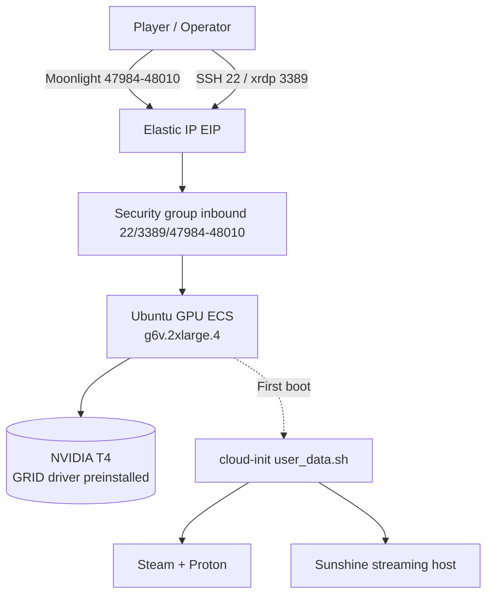

# internet-cloud-gaming-streaming

[](LICENSE)


## 1. Overview

### Introduction

This practice quickly builds a "cloud gaming / Steam" environment on Huawei Cloud using a single GPU Elastic Cloud Server (ECS): the instance is based on the **official GRID public image** (Ubuntu with NVIDIA graphics drivers preinstalled), uses **Sunshine + Moonlight** for low-latency GPU streaming, and automatically installs the desktop, Steam (Linux + Proton compatibility layer), and Sunshine on first boot. It suits scenarios that run Steam games on cloud GPU instances or perform remote graphics work.

> This practice uses the Linux + public GRID image + Sunshine/Moonlight approach, fully providing GPU + Steam + low-latency streaming capabilities.

---

## 2. Table of Contents

- [1. Overview](#1-overview)
- [2. Table of Contents](#2-table-of-contents)
- [3. Architecture Diagram](#3-architecture-diagram)
- [4. Highlights](#4-highlights)
- [5. Cloud Services Used](#5-cloud-services-used)
- [6. Prerequisites](#6-prerequisites)
- [7. Quick Start](#7-quick-start)
- [8. Step-by-Step Deployment](#8-step-by-step-deployment)
- [9. Usage / Verification](#9-usage--verification)
- [10. Cleanup](#10-cleanup)
- [11. Detailed Explanation](#11-detailed-explanation)
- [12. Dependencies](#12-dependencies)
- [13. FAQ / Troubleshooting](#13-faq--troubleshooting)
- [14. Contributing](#14-contributing)
- [15. License](#15-license)
- [16. Contact / Maintainers](#16-contact--maintainers)

```
README.md                # This file
LICENSE                  # MIT-0 license
docs/                    # Architecture description, deployment guide
infra/                   # Terraform IaC + cloud-init bootstrap script
```

---

## 3. Architecture Diagram



---

## 4. Highlights

- **A single instance is a game console**: one GPU ECS is a Steam + Sunshine streaming host, with no complex cluster to build.
- **Fully automated first boot**: cloud-init installs the desktop, Steam, Proton, and Sunshine in one pass, with no second SSH operation needed.
- **Preinstalled NVIDIA driver**: the official GRID public image has the driver preinstalled, eliminating manual driver adaptation.
- **Multi-protocol access**: Moonlight streaming + xrdp remote desktop + SSH operations, covering three entry points.
- **EIP-based access**: `assign_static_ip=true` by default, with public access through an EIP; public bandwidth is chosen according to actual traffic.

---

## 5. Cloud Services Used

This practice uses the following Huawei Cloud services:

| Service | Purpose |
|---|---|
| ECS (Elastic Cloud Server) | GPU graphics-accelerated G6v instance |
| VPC | Security group, subnet, network isolation |
| EIP (Elastic IP) | Public network entry point |
| GRID public image | Ubuntu + NVIDIA graphics driver |

---

## 6. Prerequisites

- A Huawei Cloud account with permissions to create ECS / VPC / EIP resources
- Terraform >= 1.5
- A VPC and subnet with public egress already exist in the target region
- A public Linux GPU image ID (with GRID/Graphic drivers), the target `subnet_id`, and a strong root password

---

## 7. Quick Start

```bash
cd infra
terraform init
terraform plan \
-var="image_id=72b9893f-4990-4f22-a9c3-79311555ecad" \
-var="subnet_id=<subnet-xxxx>" \
-var='admin_password=<strong-password>' \
-var="ingress_cidr=1.2.3.4/32" \
-var="assign_static_ip=true"
terraform apply
```

> This project already includes a `.tfvars` file (with image_id / subnet_id / ingress_cidr / flavor_id); only `admin_password` needs to be added (it is recommended to use the `TF_VAR_admin_password` environment variable to avoid writing it to disk).

Credentials are provided through environment variables, **never written to files**:

```bash
export HW_ACCESS_KEY="<HW_ACCESS_KEY>"
export HW_SECRET_KEY="<HW_SECRET_KEY>"
export HW_REGION_NAME="cn-north-4"
```

---

## 8. Step-by-Step Deployment

1. **Query available GPU public images** (optional): in the Huawei Cloud console, go to "Image Service → Public Images" and filter for Linux GPU images with GRID/Graphic drivers, then note the image ID (see Section 6).
2. **Terraform initialization and preview**: `cd infra && terraform init && terraform plan` (image_id / subnet_id / admin_password must be provided).
3. **Apply the deployment**: `terraform apply` creates the ECS, EIP, and security group.
4. **Wait for first boot to finish**: cloud-init automatically installs the desktop / Steam / Sunshine (about 5–15 minutes).
5. **Client access**: add `<EIP>` in Moonlight and pair with the PIN.

---

## 9. Usage / Verification

### Usage and Verification

1. After `terraform apply`, wait until the instance is ready (components are installed automatically on first boot, about 5–15 minutes).
2. Install **Moonlight** on the client, open `https://<EIP>:47990` in a browser to set up the Sunshine account, then add `<EIP>` in Moonlight and pair with the PIN.
3. After pairing, launch a game in Moonlight; games in Steam run automatically through Proton compatibility.
4. Management access: `ssh ubuntu@<EIP>` or `mstsc /v:<EIP>` (xrdp).

After deployment, follow these steps to verify that the business functionality works before considering the delivery complete.

---

## 10. Cleanup

```bash
terraform destroy # same -var arguments as above
```

---

## 11. Detailed Explanation

- The security group allows SSH(22) / xrdp(3389) / Sunshine+Moonlight(47984-48010); it is strongly recommended to restrict `ingress_cidr` to the operations egress IP /32.
- The EIP is enabled by default (`assign_static_ip=true`) and is the only public network entry point (no NAT gateway is used).
- The GPU graphics driver is **preinstalled** by the public GRID image, requiring no manual installation and supporting virtual display.

---

## 12. Dependencies

- Steam (Valve), Proton, Sunshine (LizardByte), and Moonlight are open-source / free projects of their respective communities.

---

## 13. FAQ / Troubleshooting

### FAQ

- **Moonlight cannot connect?** Check whether the security group `ingress_cidr` includes your egress IP; confirm the EIP is bound; run `systemctl status sunshine`.
- **Sunshine shows a black screen?** The X:0 virtual display is not up: SSH in and run `sudo nvidia-xconfig --enable-all-gpus --allow-empty-initial-configuration && sudo systemctl restart lightdm`, then restart sunshine.
- **A game will not run?** Steam settings → Compatibility → check "Enable Steam Play for all other titles".
- **Want to change the GPU flavor?** Change the `flavor_id` variable, noting the flavor and quota thresholds.

---

## 14. Contributing

Issues are welcome for bug reports or improvement suggestions. Please submit feedback through the project Issue channel.

---

## 15. License

This practice is licensed under the **MIT No Attribution** license. See the [`LICENSE`](LICENSE) file in the repository root for details.

The source code is released under the MIT-0 license.

---

## 16. Contact / Maintainers
| Item | Content |
|---|---|
| **Creator** | [dgc-git](https://github.com/dgc-git) |
| **Maintainer** | [dgc-git](https://github.com/dgc-git) |
| **Contact** | GitHub Issues / PR (see [Section 14](#14-contributing)) |
