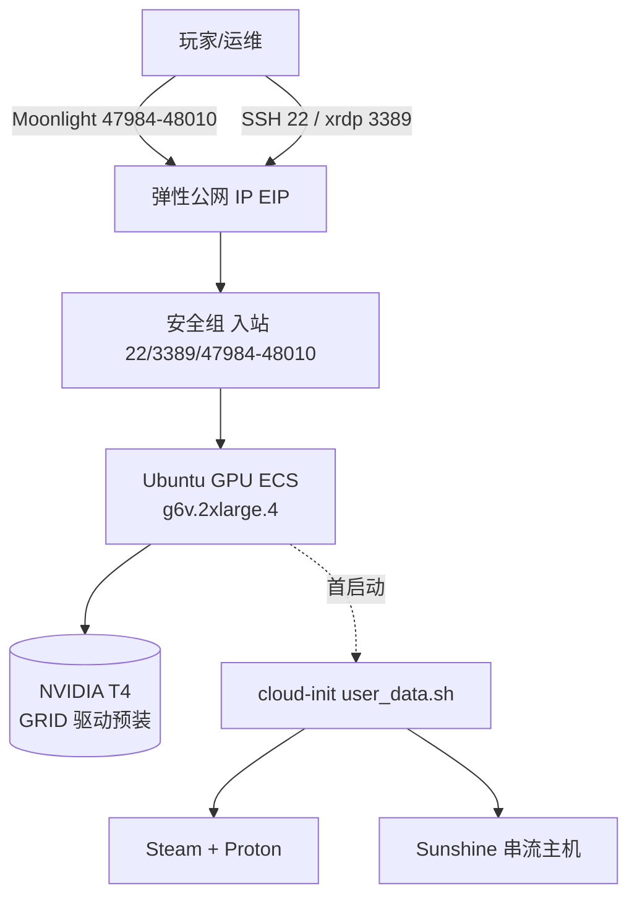

# internet-cloud-gaming-streaming · Linux GPU 云游戏实例（华为云实践 · Steam + Sunshine）

[](LICENSE)


## 1. 简介 / Overview

### 简介


本实践在华为云上用单台 GPU 弹性云服务器（ECS）快速搭建「云游戏 / Steam」运行环境：实例基于**官方 GRID 公共镜像**（Ubuntu，NVIDIA 图形驱动预装），通过 **Sunshine + Moonlight** 低延迟 GPU 串流，首启动自动安装桌面、Steam（Linux + Proton 兼容层）与 Sunshine。适用于用云上 GPU 实例跑 Steam 游戏、或进行远程图形工作的场景。

> 本实践采用 Linux + 公共 GRID 镜像 + Sunshine/Moonlight 方案，完整具备 GPU + Steam + 低延迟串流能力。

---

## 2. 目录

- [1. 简介 / Overview](#1-简介--overview)
- [2. 目录](#2-目录)
- [3. 架构图](#3-架构图)
- [4. 方案亮点](#4-方案亮点)
- [5. 涉及云服务](#5-涉及云服务)
- [6. 前置条件](#6-前置条件)
- [7. 快速开始](#7-快速开始)
- [8. 分步部署](#8-分步部署)
- [9. 使用方法 / 验证](#9-使用方法--验证)
- [10. 清理资源](#10-清理资源)
- [11. 详细说明](#11-详细说明)
- [12. 依赖](#12-依赖)
- [13. FAQ / 故障排除](#13-faq--故障排除)
- [14. 贡献指南](#14-贡献指南)
- [15. 许可证](#15-许可证)
- [16. 联系方式 / 维护者](#16-联系方式--维护者)


```
README.md                # 本文件
LICENSE                  # MIT-0 许可证
docs/                    # 架构说明、部署指导书
infra/                   # Terraform IaC + cloud-init 引导脚本
```

---

## 3. 架构图



---

## 4. 方案亮点

- **单实例即游戏机**：一台 GPU ECS 即一个 Steam + Sunshine 串流主机，免搭建复杂集群。
- **首启动全自动**：cloud-init 一次性安装桌面、Steam、Proton、Sunshine，无需 SSH 二次操作。
- **NVIDIA 驱动预装**：官方 GRID 公共镜像预装驱动，免去手动驱动适配。
- **多协议接入**：Moonlight 串流 + xrdp 远程桌面 + SSH 运维，三入口全覆盖。
- **用量型 EIP**：默认 `assign_static_ip=true`，公网走 EIP；公网带宽按实际流量选择。

---

## 5. 涉及云服务

本实践使用以下华为云服务：

| 服务 | 用途 |
|---|---|
| ECS（弹性云服务器） | GPU 图形加速型 G6v 实例 |
| VPC | 安全组、子网、网络隔离 |
| EIP（弹性公网 IP） | 公网入口 |
| GRID 公共镜像 | Ubuntu + NVIDIA 图形驱动 |

---

## 6. 前置条件

- 华为云账号，具备 ECS / VPC / EIP 创建权限
- Terraform >= 1.5
- 目标 Region 已存在具备公网出口的 VPC 与子网
- 公共 Linux GPU 镜像 ID（带 GRID/Graphic 驱动）、目标 `subnet_id`、root 强密码

---

## 7. 快速开始

```bash
cd infra
terraform init
terraform plan \
-var="image_id=72b9893f-4990-4f22-a9c3-79311555ecad" \
-var="subnet_id=<subnet-xxxx>" \
-var='admin_password=<强密码>' \
-var="ingress_cidr=1.2.3.4/32" \
-var="assign_static_ip=true"
terraform apply
```

> 本项目已附带 `.tfvars`（含 image_id / subnet_id / ingress_cidr / flavor_id），只需补 `admin_password`（建议走 `TF_VAR_admin_password` 环境变量，避免落盘）。

凭据通过环境变量提供，**勿写入文件**：

```bash
export HW_ACCESS_KEY="<HW_ACCESS_KEY>"
export HW_SECRET_KEY="<HW_SECRET_KEY>"
export HW_REGION_NAME="cn-north-4"
```

---

## 8. 分步部署

1. **查询可用 GPU 公共镜像**（可选）：在华为云控制台「镜像服务 → 公共镜像」筛选带 GRID/Graphic 驱动的 Linux GPU 镜像，记录其镜像 ID（参见第 6 节）。
2. **Terraform 初始化与预览**：`cd infra && terraform init && terraform plan`（需提供 image_id / subnet_id / admin_password）。
3. **应用部署**：`terraform apply` 创建 ECS、EIP、安全组。
4. **等待首启动完成**：cloud-init 自动安装桌面/Steam/Sunshine（约 5–15 分钟）。
5. **客户端接入**：Moonlight 添加 `<EIP>` 并 PIN 配对即可。

---

## 9. 使用方法 / 验证

### 使用方法与验证


1. `terraform apply` 后等待实例就绪（首启动自动安装组件，约 5–15 分钟）。
2. 客户端安装 **Moonlight**，浏览器打开 `https://<EIP>:47990` 设置 Sunshine 账号，Moonlight 添加 `<EIP>` 并 PIN 配对。
3. 配对后在 Moonlight 启动游戏；Steam 内游戏经 Proton 自动兼容运行。
4. 管理接入：`ssh ubuntu@<EIP>` 或 `mstsc /v:<EIP>`（xrdp）。

部署完成后请按本节步骤自行验证，确认业务功能可用，方可视为交付完成。

---

## 10. 清理资源

```bash
terraform destroy # 同上 -var 参数
```

---

## 11. 详细说明

- 安全组放行 SSH(22) / xrdp(3389) / Sunshine+Moonlight(47984-48010)；强烈建议 `ingress_cidr` 限定为运维出口 IP/32。
- EIP 默认开启（`assign_static_ip=true`），作为唯一公网出口（不使用 NAT 网关）。
- GPU 图形驱动由公共 GRID 镜像**预装**，无需手动安装、支持虚拟显示。

---

## 12. 依赖

- Steam（Valve）、Proton、Sunshine（LizardByte）、Moonlight 均为各自社区的开源/免费项目。

---

## 13. FAQ / 故障排除

### FAQ


- **Moonlight 连不上？** 检查安全组 `ingress_cidr` 是否含你的出口 IP；确认 EIP 已绑定；`systemctl status sunshine`。
- **Sunshine 黑屏？** X:0 虚拟显示未起：SSH 登入 `sudo nvidia-xconfig --enable-all-gpus --allow-empty-initial-configuration && sudo systemctl restart lightdm`，再重启 sunshine。
- **游戏跑不起来？** Steam 设置 → 兼容性 勾选「为所有游戏启用 Steam Play」。
- **想换 GPU 规格？** 改 `flavor_id` 变量，注意规格与配额阈值。

---

## 14. 贡献指南

欢迎提交 Issue 反馈问题或改进建议。请通过项目 Issue 渠道提交反馈。

---

## 15. 许可证

本实践采用 **MIT No Attribution** 许可证，详见仓库根目录 [`LICENSE`](LICENSE) 文件。


源码以 MIT-0 许可证发布。

---

## 16. 联系方式 / 维护者
| 项 | 内容 |
|---|---|
| **创建者** | [dgc-git](https://github.com/dgc-git) |
| **维护者** | [dgc-git](https://github.com/dgc-git) |
| **联系方式** | GitHub Issues / PR（见[第 14 节](#14-贡献指南)） |
