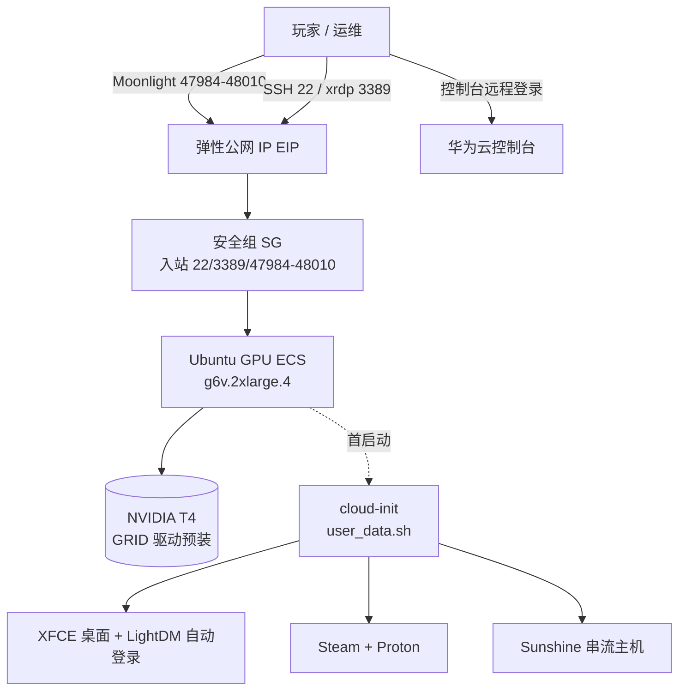

# 架构说明 · Linux GPU 云游戏实例（Steam + Sunshine）

> 本实践在华为云上用单台 GPU 弹性云服务器（ECS）搭建「云游戏 / Steam」运行环境：基于官方 GRID 公共镜像（Ubuntu，NVIDIA 图形驱动预装），通过 Sunshine + Moonlight 低延迟串流，首启动由 cloud-init 自动安装桌面、Steam 与 Sunshine。

## 架构图

## 组件说明

| 组件 | 华为云服务 | 作用 |
|------|-----------|------|
| 计算 | 弹性云服务器 ECS（GPU 规格 g6v.2xlarge.4） | 运行 Ubuntu + 游戏，提供 GPU 图形能力（GRID 驱动预装） |
| 网络接入 | 弹性公网 IP（EIP，可选） | 为实例分配静态公网 IPv4，便于远程串流 / SSH |
| 安全 | 安全组 | 入站放行 SSH(22) / xrdp(3389) / Sunshine+Moonlight(47984-48010)；出方向默认全通 |
| 引导 | cloud-init（user_data.sh） | 首启动时自动执行 bash，安装桌面 / Steam / Sunshine |
| 磁盘 | 系统盘（GPSSD） | 承载系统与游戏，默认 550GiB |

## 设计要点

- **最小化暴露面**：安全组仅开必要端口，且 `ingress_cidr` 强烈建议设为运维出口 IP/32，避免 0.0.0.0/0 暴露。
- **按需公网**：EIP 默认开启（`assign_static_ip=true`），作为唯一公网出口（不使用 NAT 网关）。
- **空闲低费**：EIP 带宽采用用量型（`charge_mode=traffic`），不开流量时近乎零费用。
- **GPU 驱动**：由公共 GRID 镜像预装，无需手动安装；支持无显示器虚拟显示（Sunshine 串流所需）。
